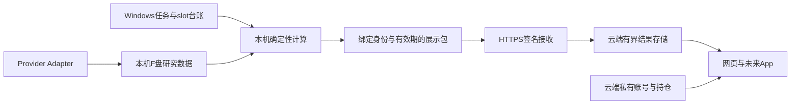

# 当前架构：本地计算，云端展示

产品目标为网页与App。当前是Vue网页，独立App尚未交付；App形态另行确定，复用研究数据与认证边界。

## 职责

F:\ETF_Data\ETF-Fund-Analysis 保存原始历史、研究SQLite、独立调度SQLite和outbox；正式任务使用固定源码工作树，分钟唤醒无到期任务不采集。指标、预测、支撑压力和回测由确定性程序计算；Codex维护工程，LLM不执行数值决策或交易，当前链路不以GPU参与作为通过条件。

local-display-v2清单绑定source/config/scope、sequence、生成/过期时间和parts哈希；执行lineage与策略配置身份分别验证。签名接收校验权限/内容/顺序/预算后原子切换generation。总览、详情和图表固定同代，代缺失不静默偷换latest；旧包重传确认不提升latest。

源码默认总存储预算320MiB、约20批，单请求/解压另有上限；实际服务器配置、磁盘/RSS须独立核实。账户、持仓、自选保留云端隔离事务，不携带于研究包。旧云端原始数据搬迁和备份是独立任务，本轮不触碰。

## 必须保持的语义

- 生成、门禁校验、发送、接收、读取时间分开；行情source_time、已结算日线、指标/预测as-of不互相替代。
- 原始/官方拆分调整研究价格不能混画，不能把研究价位复制到不等价原始图。
- 可选市场/板块部分成功或当天沿用要标原因和源时间；必要输入失败仍阻断输出。
- 调度锁、持久台账、有界重试、原子导出、过期与崩溃证据保留，不补造旧slot成功。
- Chan/结构观测区分已确认/候选/修订及因果截止；只读GET不计算、不抓取、不写库，失败不覆盖旧head。
- AI只解释冻结证据，无Shell/抓取/数据库/券商工具或数值决策权限；无静默切换供应商。
- OCR只生成可编辑候选，明确确认才入持仓；图像临时私有保存，外发另行同意。
- FTShare等外部数据只走Adapter和资格门；Demo隔离，Mock不能提升真实资格。

UNKNOWN、research_only、actionable=false、not_calibrated保持；许可/PIT/独立OOS/校准和真人验收单列。HTTP200/accepted/模拟不能替代正常登录消费、手机或两交易日稳定性。

## 安全和维护

生产AUTH_ENABLED=true、持久DATABASE_URL、AUTO_CREATE_SCHEMA=false、AUTH_COOKIE_SECURE=true；auth-bootstrap-admin初始化，浏览器正常登录。不读取或回显.env/Token/Cookie/密码。先备份、精确验证和复审，再可回滚发布；不直接写生产库。

详见 [文档地图](README.md)、[调度合同](contracts/LOCAL_CADENCE_V1.md)、[报价路由合同](contracts/QUOTE_ROUTE_DEFERRAL_V2.md)。
