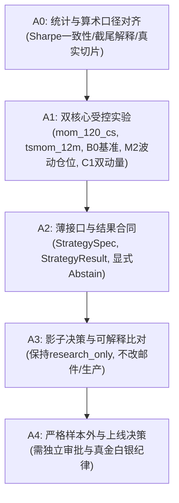

# 动量与计算决策因子验收清单

更新日期：2026年10月24日  
分支：`research/decision-momentum-validation-20261024`  
基线提交：`1a4b6652f49c412145d12812fa02820ba0a80991`  
原则：**一个可验证改动、一次测试、一个提交**

---

## 阶段门禁总览

---

## 详细验收清单

### A0 阶段：证据与算术对齐
- [x] **A0.1 文档与独立审核入库**：完整纳入第二版方案与独立审核报告。
- [ ] **A0.2 统一日频 Sharpe 口径**：消除各期限覆盖导致的 Sharpe 不一致，统一净值计算区间。
- [ ] **A0.3 真实仓位与打分分离**：区分连续分数字段（M1）与基于滞后波动率的实际调权仓位（M2）。
- [ ] **A0.4 完整保留近期切片（`recent_all_enabled`）**：如实揭示近期动量正 IC 但做多收益为负的现象。
- [ ] **A0.5 修正假说表述**：如实记录 `z_mr_20` 在 h20 四切片均为正 IC 的事实，不作「偶发为正」断言。

### A1 阶段：双核心受控增量实验
- [ ] **A1.1 基准 B0 建立**：相同标的池、相同日期、扣除相同交易摩擦的 Buy & Hold 及现金基线。
- [ ] **A1.2 时序动量 M0 验证**：原始 12 月趋势状态（$M_{252} > 0$ 多头，否则现金）。
- [ ] **A1.3 波动加权 M2 验证**：根据过去 20 日波动真实调整持仓权重 $w = \min(w_{\max}, \sigma_{\text{target}}/\sigma_{20})$，检验净收益与最大回撤变化。
- [ ] **A1.4 截面动量 C0 验证**：120 日截面排序持有策略，固定换手与选品。
- [ ] **A1.5 双动量 C1 增量消融**：验证截面排序叠加绝对动量过滤是否相比 C0 与 M0 具有统计与经济增量。
- [ ] **A1.6 有限对照组记录**：双均线（20/60）、唐奇安通道（20/10）、z分数回归、TD9 衰竭等作为对照，如实记录。

### A2 阶段：薄接口与计算决策合同
- [ ] **A2.1 StrategySpec 定义**：规范策略元数据（ID、版本、流派、参数、数据时点要求、许可）。
- [ ] **A2.2 StrategyResult 定义**：规范逐日/逐标的计算产出（`signal_score`, `rank_percentile`, `trend_state`, `target_weight`, `missing_reason`, `qualification`）。
- [ ] **A2.3 严禁伪造中性**：数据缺失时强制输出 `qualification="abstain"` 与 `missing_reason`，不填 0 或 50。
- [ ] **A2.4 中国 ETF 现实执行合同**：T+1 卖出限制、收盘信号 $t+1$ 开盘执行、20 bps 往返成本、无印花税。

### A3 阶段：影子决策对照（不改实盘）
- [ ] **A3.1 保持生产边界**：不连接券商，不自动下单，不修改 live 采集/定时任务，不改动策略邮件。
- [ ] **A3.2 标记保持**：所有实验产物显式包含 `research_only=true` 与 `actionable=false`。
- [ ] **A3.3 并行可解释比对**：将新策略目标仓位与现行五档动作（`SignalGradeService`）进行离线影子比对。

### A4 阶段：生产准入关卡
- [ ] **A4.1 独立样本外测试**：在未参与探索决策的新时间序列上测试。
- [ ] **A4.2 交易层指标硬门槛**：扣除全成本后逐笔净胜率、盈亏比与净 Sharpe 达标。
- [ ] **A4.3 用户显式人工批准**：未获 Jovi 明确指令前，绝不向实盘部署。
