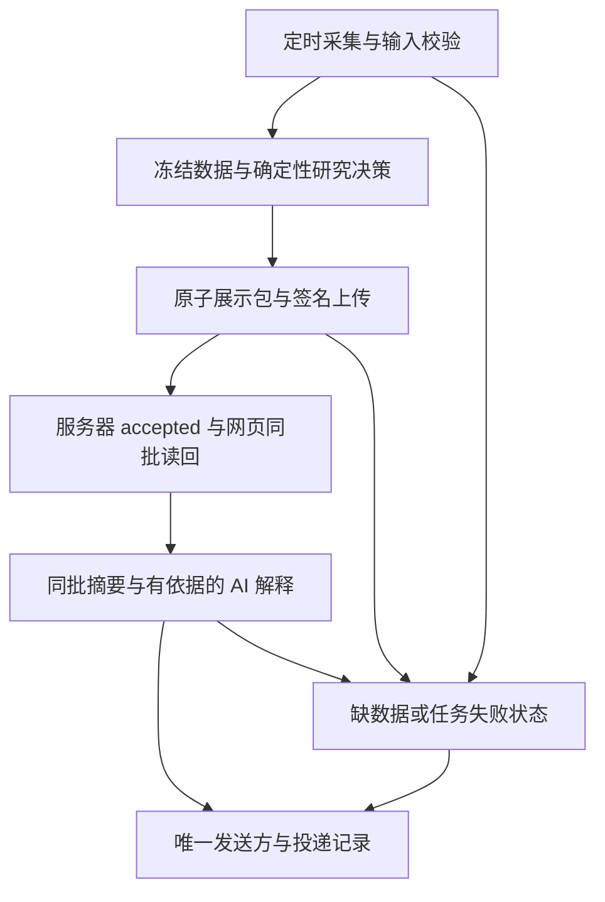

# 每日采集、决策、网站与邮件修复计划

日期：2026-10-26；状态：PLAN_READY，尚未实施。

## 1. 目标、基线和授权边界

目标：交易日自动采集本机研究数据，计算可追溯的研究决策，更新网站，并按时发送同批结果及 AI 解释；无合格新结果时明确通知延迟/失败，不能整晚无消息。研究数据留在 F 盘，云端保留有界展示包与账户事务。非交易日展示最近交易日结果并标历史，不伪造新行情。

依据：[现场报告](../../docs/audits/DAILY_PIPELINE_GAP_20261026.md)、[机器证据](../../docs/audits/DAILY_PIPELINE_EVIDENCE_20261026.json)。它们是 10-26 22:38–23:01 的观察，不是下一候选的验收收据。

- 当前 E 根 main 为 `7b3a575`，网站 v1.0.12 / image `1863c32d…`；实际本地生产者为 `dcffa8e`。开始实施时重新核 main、其他 Agent、Windows Action、服务镜像和接收身份。
- 已证实：5 批成功；收盘日线 34/34，但 10 条 16:29 报价被闭市 15:00–16:00 合同阻断；快槽出包耗掉有效窗口；AI/邮件未进入同一台账。
- 尚未知：首次上传异常的完整原因；历史 `mail.grokbot.com` 对应任务的当前运行位置、计划和错误。不得把它们编成已确认根因。
- 本轮只授权制定计划、写计划与任务记录。实施前集中确认这份文件清单与运行范围；代码、GitHub提交/合并、生产切换、真实采集和真实邮件分别按既有人类授权核对，未涵盖的动作不推定获准。
- 实施用独立 `codex/` 分支和合适的干净工作树；保留当前未提交报告及 Owner 工作。不 reset/clean/stash、强推或覆盖其他 Agent。
- 不改 Provider 实现、策略权重/阈值、账户/持仓、F 盘旧数据或备份；不启用云端行情 scheduler，不自动交易，不弹终端或浏览器窗口。

## 2. 结果依赖与建议时间



AI失败时仍发布确定性结果，邮件明确说明解释不可用；邮件失败不撤销网站结果。网页接收失败时邮件可以发故障摘要，但必须说明“网站尚未更新”，不能冒充正常同批发布。

| 产物 | 建议安排（北京时间，待批准启用） | 目标与超时行为 |
|---|---|---|
| 数据/网站 | 保留现有 12 槽；不先增加唤醒频率 | 快槽从最早输入 source_time 到 accepted 目标 ≤4 分钟，原 8 分钟门槛保持；这是待实测目标 |
| 午间/盘中邮件 | 沿用已有 11:40、14:30、14:45 槽的结果 | 对应槽开始后 10 分钟内发结果或延迟状态；不能用上一槽替代本槽而不注明 |
| 收盘研究 | 保留 15:15、16:10、16:40、17:40 的完整刷新 | 数据未齐按已有有限重试继续；目标日已齐才计算当日研究 |
| 收盘邮件 | 建议 18:00 汇总 | 取当天已验证收盘批次；没有则发送失败/延迟摘要，不把盘中包改名收盘 |
| 日终对账 | 保留 16:30 中间对账，增加 18:15 最终对账 | 中间对账不能代替最后收盘结果；若需晚间补跑，先定义有界新槽，不修改旧失败记录 |

不把上述计划自动写入 Windows 或外部服务。本机需要开机、登录及网络；本地程序不能在电脑离线时自发告警，缺席检测必须由一个持续在线的发送/检查服务承担。

## 3. P0：先让失败有准确、可持久的记录

前提：冻结当前身份和只读基线；不重跑旧候选全量测试。

- [ ] 在现有 jobs 台账复用阶段任务及 `duration_seconds/reason/error_type`，记录 base 校验、计算、详情/图表投影、序列化/哈希、写盘、发送前检查、网络/回执、消费读回的开始/结束和净化错误码。
- [ ] 首次 upload 失败也写入实际错误类别和阶段；不再只在隐藏 stdout 打印。禁止记录凭据、完整载荷、收件人、原始异常正文或个人持仓。
- [ ] 分开统计 idle/跳过、计算失败、过龄、发送未确认、服务器接受、网页同批读回；不改变 Windows 正常空轮询退出 0 的语义，也不把它当全天成功。
- [ ] 保留先前 FAILED/MISSED 记录；新修复使用新 attempt/候选 SHA，不回写历史。

文件：`scripts/run_local_compute.py`、`backend/app/workspace/local_dispatch.py`、`local_job_ledger.py`、`local_reconcile.py`、`scripts/observe_local_cadence.py`；优先扩展现有 details 白名单；诊断 phase 不能冒充业务 stage/TaskRun。若新增诊断行，须同步明确其类型并适配 local_stability 的 unexpected_execution_stage 检查，不能放宽真实必需阶段验证；确需新字段才做向后兼容的本地账本升级。

先 RED：首次发送失败持久化、进程崩溃恢复、有限重试、idle 不算日成功、敏感异常净化。测试落点：`test_local_dispatch.py`、`test_local_job_ledger.py`、`test_local_task_crash.py`、`test_local_reconcile.py`、`test_cadence_observer.py`。

证据：新 SHA 的阶段耗时/错误摘要，状态最多为 `DIAGNOSABLE`。失败保留旧任务和包；可回滚代码，不能删除旧台账。

## 4. P1：恢复可信的收盘研究与网站更新（第一优先交付）

前提：P0可记录真实失败。34/34 日线只是必要条件，仍须验证质量、来源、复权、日历、实际派生输入和目标范围。

- [ ] 先用本次“日线完整、10条报价为16:29”的夹具复现失败；保留旧闭市 quote proof 的时间窗及全部拒绝测试。
- [ ] 复用 `settlement.settled_session`、`_base_state` 和现有 base manifest 校验，提取小型共用校验器；不新增调度框架。
- [ ] 保留现有执行 `mode=full`；新增明确版本化的 `input_observation` 字典内的 `type=settled_daily_research` 依据标识及数据库/交易日/scope/输入 hash 绑定（具体字段随合同冻结；不能将整个字典替换为字符串），不增加第三套执行 mode。
- [ ] 在明确闭市研究范围内，将完整已结算日线作为计算依据；报价可作为非实时时点展示，原 TaskRun partial、原 source_time 和降级状态必须保留。
- [ ] 同时审核所有下游价格选择：`SignalGradeService.build` 读取的报价涨幅、`SignalService._build_candidate` 读取的量额/溢价，不能在标为“收盘研究”的结果中无说明地混入旧报价。复用统一的输入选择上下文；日线能证明的价格/量额使用同日同口径数据，无法证明的溢价/资金流等保持缺失及门控，不猜值、不换权重。
- [ ] 证明贯穿 compute → lineage → export → 接收/Reader → 详情与摘要。导出前重核被冻结输入与派生结果；不能接受外部 JSON 自称 `accepted=true`。
- [ ] 保留合法旧包兼容、HMAC/回放/预算门禁及 same-generation GET；市场背景可选失败与必需日线失败分别记录。
- [ ] 更新相关数据依据/策略版本及四处应用版本、CHANGELOG。输入选择变化须产生与旧版/基准的数值对照、时间序列 walk-forward、事件驱动组合回测和泄漏检查；报告未验证项，不把研究展示发布等同策略封版或 calibrated。

最小文件范围：

- `backend/app/workspace/local_compute.py`、`local_display_contract.py`、`local_display_read.py`；`scripts/run_local_compute.py`。
- `backend/app/services/settlement.py`（仅有必要时提取共用检查）、`signal_grade_service.py`、`signal_service.py`；`task_service.py`、`decision_board_service.py` 仅为传递统一输入上下文做必要窄适配。
- `local_dispatch.py`、`local_job_ledger.py`、`local_stability.py` 仅适配依据记录/核验，保留 full/fast 合同。
- `config/strategy.json` 的相关版本、`pyproject.toml`、`backend/app/core/config.py`、`frontend/package.json`/lock、`CHANGELOG.md`；不趁机改指标公式或预测特征。

先 RED 的关键边界：16:29仍不算实时；bar涨幅与旧quote涨幅故意不同；缺bar/旧日线/未来bar/未核日历/复权混用/缺来源质量/旧指标预测/hash/SHA/scope/数据库移植/伪造证明均不能通过；15:15前不能冒充已结算；旧合法包继续可读。

测试落点：`test_closed_session_research.py`、`test_local_fast_compute.py`、`test_cadence_cli.py`、`test_local_execution_scope.py`、`test_local_execution_identity.py`、`test_local_stability.py`、`test_signal_grade.py`、`test_signal_grade_units.py`、`test_decision_board.py`、展示合同/Reader/报价权威测试。

证据：`SETTLED_RESEARCH_CANDIDATE_VERIFIED`；真实新交易日/明确标为历史的10-26重算需证明新日线 → 新派生结果 → 新包 → accepted → 同批 GET。历史重算不得修改当天旧失败记录，也不能当作自然运行通过。质量仍 UNKNOWN/actionable=false/not_calibrated。

失败：保留上一批准包并标历史，输出具体阻断原因；回到冻结的旧生产者/网站组合，禁止全局忽略 quotes partial。

## 5. P2：修复快槽时效与上传恢复

前提：使用 P0真实分项耗时定位热点；不要把“首次错误未知”改写成网络故障。

- [ ] 测量 `_base_state` 重复全库扫描、各详情/图表投影、JSON/哈希和写盘成本，先优化实测最大的部分。
- [ ] 在同一冻结 base/input hash 和持锁范围内复用不可变投影/校验结果；发送前仍做足以发现配置、输入或文件变化的校验，不用 TTL 缓存冒充输入不变。
- [ ] 保留原 source_time 的8分钟限制；可重放的包只重发原字节。过龄包终止该次投递并等下一槽新采报价，不改 generated_at、不无限重试。
- [ ] 同时观察普通槽、14:30临界槽、15:00/15:15切换；目标 source_time→accepted≤4分钟且所有发送均在有效窗内，未达标就如实失败，不能用均值掩盖失败槽。

文件以 `local_compute.py`、`scripts/run_local_compute.py`、`local_dispatch.py` 为主；只有新测量证明传输瓶颈才改 `shadow_client.py`，不删除图表或历史字段来凑速度。

测试：`test_local_fast_compute.py`、`test_local_display_projection.py`、`test_local_dispatch.py`、`test_local_display_bundle_cache.py`、`test_local_delivery_receipt.py`、`test_shadow_failure_recovery.py`；覆盖8分钟前后、旧source/new生成时间、重启重复上传、scope/配置变化、缓存污染和同包哈希。

证据：固定 SHA 的分项对照、实际延迟及失败样本，状态 `FAST_SLOT_BUDGET_VERIFIED`。失败回滚性能改动，继续诚实的历史展示与失败状态通知。

## 6. P3：接上 AI 解释、唯一邮件发送方与缺席通知

外部任务核查可与 P0–P2 并行，只读核查不应阻塞收盘代码候选；真实启用依赖批准的运行合同。

- [ ] 先取得历史邮件对应任务的 ID、所属平台/owner、Asia/Shanghai计划、last/next run、今日错误和投递记录。发件域不证明存在可调用API，也不证明任务停用。
- [ ] 明确唯一发送 owner。优先复用能持续运行、可审计的既有服务；若不可用，再选项目维护的邮件适配器。若迁移，先确认旧计划停用并读回，再启用新发送；回滚也只能有一个活跃发送方。
- [ ] 复用 `AnalysisService` 和 `backend/app/analysis` 的适配器/严格合同，只给模型有界、校验后的同批研究事实；模型不读取凭据/个人持仓，不拥有 Shell、数据库、抓取或交易工具，也不计算数值指标。
- [ ] AI解释绑定 session/slot/generation/bundle hash/input hash/model/prompt版本；结果无依据、超时或失败时使用明确标识的确定性摘要，不伪装 AI 成功。
- [ ] 新建小型 `backend/app/workspace/local_digest.py`：构造冻结摘要；新建 `local_notifications.py`：持久队列、owner、去重、有限重试和传输状态。复用账本/回执，通知不能长期占用计算锁。
- [ ] 同槽重复唤醒或重启不重复发正常邮件。区分 READY/SENDING/ACCEPTED/DELIVERED/FAILED/AMBIGUOUS；供应商接受不等于收件箱送达。发送超时且不知是否已收时先查询/对账，供应商无幂等查询能力不得承诺 exactly-once 或盲重发。
- [ ] 到截止时没有本槽新结果，也发数据未就绪/网站未更新状态；迟到补发注明原槽、真实数据时点及实际发送时间。
- [ ] 由持续在线的同一发送服务做缺席检测；若迁移本地发送，需一个有界云端“缺席检查”入口，仅读心跳/回执并通知，不拉行情、不重算、不打开全局 scheduler。先核既有托管能力再确定这一适配器；不在选择前新建第二套调度。
- [ ] 凭据仅使用已批准的私有运行配置；默认发送关闭，dry-run写预览，不安装新工具或购买服务，不在文档/日志中放地址、Token和邮件正文。真实发送/切换须核明确授权。

配套文件：`scripts/run_local_compute.py` 的独立通知入口、必要的 `core/config.py` 私有通知开关；上述两份新模块；新建 `test_local_digest.py`、`test_local_notifications.py`，复用 `test_analysis_gateway.py`、`test_analysis_persistence.py`、`test_report_artifact_contract.py`。若需云端缺席适配器，先列明准确文件与触发方式再纳入同一批准范围，不扩大成云端采集。

验收：AI失败但网站可用；邮件失败不撤销网站；无数据/过期/网站拒绝时不发正常当日决策；模拟超时/崩溃不双发；补发标时清楚；用实际投递标识和本人邮箱确认一封同批邮件。可支持的状态分 `PREVIEW_VERIFIED`、`PROVIDER_ACCEPTED`、`OWNER_RECEIVED`，分别记录。

## 7. P4：固定候选、复审、受控发布与自然运行

- [ ] P1可作为第一批恢复日终展示的候选，P2/P3随后整合；任何中间发布均只声明其实际完成范围。完整目标须全部链路验收。
- [ ] 每个候选冻结 SHA/tree、策略/输入合同版本和测试工件；旧测试计数只作基线，不继承为新 SHA 通过。
- [ ] 新失败测试先 RED，再最小修复 GREEN。最终执行下列全量/静态/前端门禁；涉及HTTP/页面的认证浏览器验收用无头方式，不能弹窗抢焦点。

```powershell
E:/project/ETF-Fund-Analysis/.venv/Scripts/python.exe -m pytest -q
E:/project/ETF-Fund-Analysis/.venv/Scripts/python.exe -m compileall -q backend/app
node --check backend/app/static/app.js
npm --prefix frontend run typecheck
npm --prefix frontend test
npm --prefix frontend run build
```

聚焦命令（在获准实施工作树执行，同一运行时）：

```powershell
python -m pytest -q backend/tests/test_closed_session_research.py backend/tests/test_local_fast_compute.py backend/tests/test_cadence_cli.py backend/tests/test_local_dispatch.py backend/tests/test_local_job_ledger.py backend/tests/test_local_stability.py backend/tests/test_local_execution_scope.py backend/tests/test_local_execution_identity.py
python -m pytest -q backend/tests/test_local_display_contract.py backend/tests/test_local_display_read.py backend/tests/test_local_display_consumer_contract.py backend/tests/test_display_quote_authority.py backend/tests/test_signal_grade.py backend/tests/test_signal_grade_units.py backend/tests/test_decision_board.py
python -m pytest -q backend/tests/test_local_digest.py backend/tests/test_local_notifications.py backend/tests/test_analysis_gateway.py backend/tests/test_local_reconcile.py
```

以上是未来命令，尚未运行。新增通知测试仅在P3模块存在后执行；Python须解析到同一项目依赖环境。精确 GitHub CI 必须绑定最终候选；独立只读复审和同一“基金决策”项目普通网页GPT复审通过后才合main，不新建Cloud Work。网页不可用不冒称通过。

- [ ] 受控发布前做一致性备份并验证 hash/可列目录；保留旧镜像、展示包、任务 XML、接收身份及回滚脚本。主任务迁移必须核producer SHA/config/执行身份/登记表和接收端，不能只改Windows工作目录或一边先切身份。
- [ ] 候选/新旧身份切换需先在隔离store验证，迁移过程保持单写者；不为让页面有数而把任意SHA登记为批准。
- [ ] 新包接收后核默认总览、详情、图表、自选同generation和真实source/daily/decision时点；持仓空态保留。正常登录、邮箱收件和本人手机分别验。
- [ ] 最终收据串起 attempt → 数据/派生hash → bundle → accepted → GET → AI结果hash → 邮件投递标识，明列每阶段状态。最终对账发现失败时不能让后续空轮询0覆盖它。
- [ ] 验两个真实交易日的自然运行，再观察7–14日；不把手动补跑算自然触发。若切换完成且为交易日，最早观察窗口拟10-27/10-28，按实际日期/日历记录，不倒填。

失败回滚：恢复已冻结的旧生产者/接收身份/网站镜像和旧任务Action；单发送owner恢复，保留失败证据和新账本记录。若新账本升级，保持旧代码可忽略新增内容；不回滚覆盖账户数据或把F盘恢复成旧快照。恢复旧版会恢复旧缺陷，报告必须明确这一限制。

状态只依证据升级：`CANDIDATE_VERIFIED → EXACT_CI_PASSED → WEB_REVIEW_PASSED → DEPLOYED_VERIFIED → NATURAL_CHAIN_VERIFIED`。最后一个状态要求数据、网页和实际收件均成功，不能只凭容器healthy。

## 8. 本轮交付与停止点

本轮交付本计划和tasks/todo勾选项；未修改业务代码/版本/任务/配置/数据，未执行采集、发信、提交、合并或部署。计划经两个独立方向复核：优先复用full/base证明、补查下游报价输入及TaskService/DecisionBoard上下文传递、区分诊断phase与业务stage、分离AI/网站/邮件结果及唯一发送owner。

下一动作：集中确认P0–P1的代码范围及离线验证授权后，从失败测试开始实施；邮件任务归属只读核查并行。生产与发送切换按实际权限和已冻结收据执行，不能将本计划当作新的授权。

项目Hub：本次计划阶段revision查询仍为WinError10061，未上报，未自动重试；不影响本地计划交付。此计划是临时执行工件，不同步为Obsidian已完成成果（NO_MEMORY_UPDATE）。
